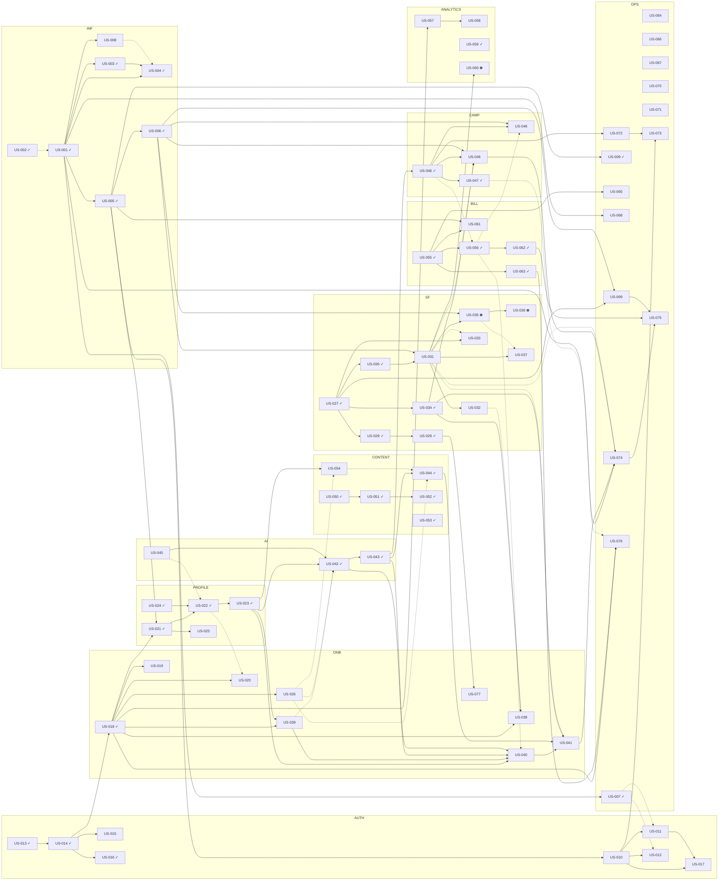

# User Story Dependencies

> Generated by `node scripts/backlog/render.mjs` from `scripts/backlog/stories-*.mjs`. Do not edit by hand.

**77 stories** · Done 35 · Ready 3 · Backlog 27 · Blocked 3 · P0 44 · P1 27 · P2 6

Codes: INF infrastructure · AUTH authentication · ONB onboarding · PROFILE product intelligence · SF SocialFlow.ai and distribution · AI AI services · CONTENT content · CAMP campaigns · BILL credits · ANALYTICS analytics · OPS operations, security, UX and QA.

## Graph

Solid arrows are blocking dependencies; dotted arrows are optional. ✓ done, ⛔ blocked on an external dependency.

## Dependency table

| Story | Code | Priority | Status | Blocking deps | Optional deps | External / API deps | Wave |
| --- | --- | --- | --- | --- | --- | --- | --- |
| [US-001](USER_STORIES.md#us-001) | INF | P0 | Done | — | US-002 | — | 0 |
| [US-002](USER_STORIES.md#us-002) | INF | P0 | Done | — | — | — | 0 |
| [US-003](USER_STORIES.md#us-003) | INF | P0 | Done | US-001 | — | — | 0 |
| [US-004](USER_STORIES.md#us-004) | INF | P0 | Done | US-001, US-003 | US-008 | — | 0 |
| [US-005](USER_STORIES.md#us-005) | INF | P0 | Done | US-001 | — | — | 0 |
| [US-006](USER_STORIES.md#us-006) | INF | P0 | Done | US-005 | — | — | 0 |
| [US-007](USER_STORIES.md#us-007) | OPS | P0 | Done | US-001 | — | — | 0 |
| [US-008](USER_STORIES.md#us-008) | INF | P1 | Backlog | US-001 | — | — | 1 |
| [US-009](USER_STORIES.md#us-009) | OPS | P1 | Done | US-005 | — | — | 0 |
| [US-010](USER_STORIES.md#us-010) | AUTH | P0 | Ready | US-005 | — | SMTP provider (production) | 1 |
| [US-011](USER_STORIES.md#us-011) | AUTH | P0 | Backlog | US-010 | US-007 | SMTP | 2 |
| [US-012](USER_STORIES.md#us-012) | AUTH | P0 | Backlog | US-010 | US-007 | SMTP | 2 |
| [US-013](USER_STORIES.md#us-013) | AUTH | P0 | Done | — | — | — | 0 |
| [US-014](USER_STORIES.md#us-014) | AUTH | P0 | Done | US-013 | — | — | 0 |
| [US-015](USER_STORIES.md#us-015) | AUTH | P1 | Backlog | US-014 | — | — | 1 |
| [US-016](USER_STORIES.md#us-016) | AUTH | P0 | Done | US-014 | — | — | 0 |
| [US-017](USER_STORIES.md#us-017) | AUTH | P2 | Backlog | US-010, US-011 | — | SMTP | 3 |
| [US-018](USER_STORIES.md#us-018) | ONB | P0 | Done | US-014 | — | — | 0 |
| [US-019](USER_STORIES.md#us-019) | ONB | P0 | In Progress | US-018 | — | — | 1 |
| [US-020](USER_STORIES.md#us-020) | ONB | P0 | Backlog | US-018 | US-022 | — | 1 |
| [US-021](USER_STORIES.md#us-021) | PROFILE | P0 | Done | US-018, US-005 | — | The product's public website | 0 |
| [US-022](USER_STORIES.md#us-022) | PROFILE | P0 | Done | US-021, US-024 | US-045 | AI provider (optional) | 0 |
| [US-023](USER_STORIES.md#us-023) | PROFILE | P0 | Done | US-022 | — | — | 0 |
| [US-024](USER_STORIES.md#us-024) | PROFILE | P0 | Done | — | — | — | 0 |
| [US-025](USER_STORIES.md#us-025) | PROFILE | P0 | Review | US-021 | — | — | 1 |
| [US-026](USER_STORIES.md#us-026) | ONB | P1 | Backlog | US-018 | — | — | 1 |
| [US-027](USER_STORIES.md#us-027) | SF | P0 | Done | — | — | — | 0 |
| [US-028](USER_STORIES.md#us-028) | SF | P0 | Done | US-027 | — | — | 0 |
| [US-029](USER_STORIES.md#us-029) | SF | P0 | Done | US-028 | — | — | 0 |
| [US-030](USER_STORIES.md#us-030) | SF | P0 | Done | US-027 | — | — | 0 |
| [US-031](USER_STORIES.md#us-031) | SF | P0 | Review | US-030, US-006 | — | SocialFlow.ai API (for live use only); SocialFlow.ai C1, C3, C5, C7 | 1 |
| [US-032](USER_STORIES.md#us-032) | SF | P1 | Review | US-031 | — | SocialFlow.ai C2, C3, C10; SocialFlow.ai account connection | 2 |
| [US-033](USER_STORIES.md#us-033) | SF | P1 | Backlog | US-027 | US-031 | — | 1 |
| [US-034](USER_STORIES.md#us-034) | SF | P0 | Done | US-027 | — | — | 0 |
| [US-035](USER_STORIES.md#us-035) | SF | P1 | Blocked | US-031, US-006 | — | SocialFlow.ai C7; SocialFlow.ai status | 2 |
| [US-036](USER_STORIES.md#us-036) | SF | P2 | Blocked | US-035 | — | SocialFlow.ai C8; SocialFlow.ai webhooks | 3 |
| [US-037](USER_STORIES.md#us-037) | SF | P0 | Ready | US-031 | US-035 | SocialFlow.ai deployed API; SocialFlow.ai sandbox account; SocialFlow.ai C1, C3, C5, C7 | 2 |
| [US-038](USER_STORIES.md#us-038) | ONB | P1 | Backlog | US-018, US-034 | US-032 | — | 1 |
| [US-039](USER_STORIES.md#us-039) | ONB | P1 | Backlog | US-018, US-023 | — | — | 1 |
| [US-040](USER_STORIES.md#us-040) | ONB | P0 | Backlog | US-023, US-039, US-042, US-043 | US-056 | — | 2 |
| [US-041](USER_STORIES.md#us-041) | ONB | P0 | Backlog | US-040, US-044, US-034 | US-031 | — | 3 |
| [US-042](USER_STORIES.md#us-042) | AI | P0 | Done | US-023, US-045 | US-039, US-026 | AI provider (optional) | 0 |
| [US-043](USER_STORIES.md#us-043) | AI | P0 | Done | US-042 | — | — | 0 |
| [US-044](USER_STORIES.md#us-044) | CONTENT | P0 | Done | US-043 | US-026, US-054 | AI provider (optional) | 0 |
| [US-045](USER_STORIES.md#us-045) | AI | P1 | Review | — | — | — | 1 |
| [US-046](USER_STORIES.md#us-046) | CAMP | P0 | Done | US-043 | — | — | 0 |
| [US-047](USER_STORIES.md#us-047) | CAMP | P1 | Done | US-046 | — | — | 0 |
| [US-048](USER_STORIES.md#us-048) | CAMP | P1 | Review | US-046, US-006 | US-056 | — | 1 |
| [US-049](USER_STORIES.md#us-049) | CAMP | P0 | Review | US-046, US-006, US-034 | US-031 | — | 1 |
| [US-050](USER_STORIES.md#us-050) | CONTENT | P0 | Done | — | — | — | 0 |
| [US-051](USER_STORIES.md#us-051) | CONTENT | P0 | Done | US-050 | — | — | 0 |
| [US-052](USER_STORIES.md#us-052) | CONTENT | P0 | Done | US-051 | — | — | 0 |
| [US-053](USER_STORIES.md#us-053) | CONTENT | P1 | Done | — | — | — | 0 |
| [US-054](USER_STORIES.md#us-054) | CONTENT | P1 | Backlog | US-023 | US-026 | — | 1 |
| [US-055](USER_STORIES.md#us-055) | BILL | P0 | Done | — | — | — | 0 |
| [US-056](USER_STORIES.md#us-056) | BILL | P0 | Done | US-055 | US-046 | — | 0 |
| [US-057](USER_STORIES.md#us-057) | ANALYTICS | P0 | Review | US-018 | — | — | 1 |
| [US-058](USER_STORIES.md#us-058) | ANALYTICS | P1 | Review | US-057 | — | — | 2 |
| [US-059](USER_STORIES.md#us-059) | ANALYTICS | P1 | Done | — | — | — | 0 |
| [US-060](USER_STORIES.md#us-060) | ANALYTICS | P2 | Blocked | US-031 | — | SocialFlow.ai C9; SocialFlow.ai analytics | 2 |
| [US-061](USER_STORIES.md#us-061) | BILL | P1 | Backlog | US-055, US-005 | — | — | 1 |
| [US-062](USER_STORIES.md#us-062) | BILL | P0 | Done | US-056 | — | — | 0 |
| [US-063](USER_STORIES.md#us-063) | BILL | P1 | Done | US-055 | — | — | 0 |
| [US-064](USER_STORIES.md#us-064) | OPS | P1 | Backlog | — | — | — | 1 |
| [US-065](USER_STORIES.md#us-065) | OPS | P1 | Backlog | US-055 | — | — | 1 |
| [US-066](USER_STORIES.md#us-066) | OPS | P1 | Backlog | — | — | — | 1 |
| [US-067](USER_STORIES.md#us-067) | OPS | P1 | Backlog | — | — | GitHub Actions | 1 |
| [US-068](USER_STORIES.md#us-068) | OPS | P1 | Backlog | US-001 | — | — | 1 |
| [US-069](USER_STORIES.md#us-069) | OPS | P1 | Backlog | US-027, US-006 | — | — | 1 |
| [US-070](USER_STORIES.md#us-070) | OPS | P2 | Ready | — | — | — | 1 |
| [US-071](USER_STORIES.md#us-071) | OPS | P2 | Backlog | — | — | — | 1 |
| [US-072](USER_STORIES.md#us-072) | OPS | P1 | Backlog | US-046 | — | — | 1 |
| [US-073](USER_STORIES.md#us-073) | OPS | P2 | Backlog | US-010, US-072 | — | SMTP | 2 |
| [US-074](USER_STORIES.md#us-074) | OPS | P0 | Backlog | US-001, US-041, US-049 | US-031 | — | 4 |
| [US-075](USER_STORIES.md#us-075) | OPS | P0 | Backlog | US-074, US-062, US-069 | — | — | 5 |
| [US-076](USER_STORIES.md#us-076) | OPS | P1 | Backlog | US-018, US-063 | US-047 | — | 1 |
| [US-077](USER_STORIES.md#us-077) | ONB | P1 | Backlog | US-029 | — | — | 1 |

## Parallelisable waves

Stories in the same wave have no blocking dependency on each other and can be built in parallel once the previous wave is done. Wave 0 is already delivered.

- **Wave 0**: US-001, US-002, US-003, US-004, US-005, US-006, US-007, US-009, US-013, US-014, US-016, US-018, US-021, US-022, US-023, US-024, US-027, US-028, US-029, US-030, US-034, US-042, US-043, US-044, US-046, US-047, US-050, US-051, US-052, US-053, US-055, US-056, US-059, US-062, US-063
- **Wave 1**: US-008, US-010, US-015, US-019, US-020, US-025, US-026, US-031, US-033, US-038, US-039, US-045, US-048, US-049, US-054, US-057, US-061, US-064, US-065, US-066, US-067, US-068, US-069, US-070, US-071, US-072, US-076, US-077
- **Wave 2**: US-011, US-012, US-032, US-035, US-037, US-040, US-058, US-060, US-073
- **Wave 3**: US-017, US-036, US-041
- **Wave 4**: US-074
- **Wave 5**: US-075

## Critical path

The longest chain of blocking dependencies ending in a P0 story (5 stories). Any delay here delays the MVP.

[US-039](USER_STORIES.md#us-039) → [US-040](USER_STORIES.md#us-040) → [US-041](USER_STORIES.md#us-041) → [US-074](USER_STORIES.md#us-074) → [US-075](USER_STORIES.md#us-075)

## External dependencies

| Dependency | Stories | Status |
| --- | --- | --- |
| AI provider (optional) | US-022, US-042, US-044 | Available or optional |
| GitHub Actions | US-067 | Available or optional |
| SMTP | US-011, US-012, US-017, US-073 | Available or optional |
| SMTP provider (production) | US-010 | Available or optional |
| SocialFlow.ai API (for live use only) | US-031 | **Unavailable** (no API exists) |
| SocialFlow.ai C1, C3, C5, C7 | US-031, US-037 | **Unavailable** (no API exists) |
| SocialFlow.ai C2, C3, C10 | US-032 | **Unavailable** (no API exists) |
| SocialFlow.ai C7 | US-035 | **Unavailable** (no API exists) |
| SocialFlow.ai C8 | US-036 | **Unavailable** (no API exists) |
| SocialFlow.ai C9 | US-060 | **Unavailable** (no API exists) |
| SocialFlow.ai account connection | US-032 | **Unavailable** (no API exists) |
| SocialFlow.ai analytics | US-060 | **Unavailable** (no API exists) |
| SocialFlow.ai deployed API | US-037 | **Unavailable** (no API exists) |
| SocialFlow.ai sandbox account | US-037 | **Unavailable** (no API exists) |
| SocialFlow.ai status | US-035 | **Unavailable** (no API exists) |
| SocialFlow.ai webhooks | US-036 | **Unavailable** (no API exists) |
| The product's public website | US-021 | Available or optional |

## Integration risks

1. **SocialFlow.ai has no API (critical).** Blocks US-035, US-036, US-060. Mitigation: contract + mocked adapter (US-030, US-031) and export mode (US-034) keep the journey working; enabling the adapter is gated by the live smoke test (US-037).
2. **Primary activation metric cannot be met through SocialFlow.ai** until US-037 passes. Mitigation: report both "through SocialFlow.ai" and "any path" honestly (US-058).
3. **Email delivery needs an SMTP provider in production.** US-011, US-012, US-017, US-073 depend on US-010. Mitigation: labelled dev transport; production config documented.
4. **AI provider availability.** Every AI workflow has a labelled deterministic fallback (US-022, US-042, US-044).
5. **Redis introduces a new runtime dependency.** Postgres remains the source of truth; idempotency keys make duplicate or lost messages harmless (ADR-002).

## Most depended-on stories

- [US-018](USER_STORIES.md#us-018) unblocks 8: US-019, US-020, US-021, US-026, US-038, US-039, US-057, US-076
- [US-001](USER_STORIES.md#us-001) unblocks 7: US-003, US-004, US-005, US-007, US-008, US-068, US-074
- [US-005](USER_STORIES.md#us-005) unblocks 5: US-006, US-009, US-010, US-021, US-061
- [US-006](USER_STORIES.md#us-006) unblocks 5: US-031, US-035, US-048, US-049, US-069
- [US-027](USER_STORIES.md#us-027) unblocks 5: US-028, US-030, US-033, US-034, US-069
- [US-010](USER_STORIES.md#us-010) unblocks 4: US-011, US-012, US-017, US-073
- [US-023](USER_STORIES.md#us-023) unblocks 4: US-039, US-040, US-042, US-054
- [US-031](USER_STORIES.md#us-031) unblocks 4: US-032, US-035, US-037, US-060
- [US-046](USER_STORIES.md#us-046) unblocks 4: US-047, US-048, US-049, US-072
- [US-055](USER_STORIES.md#us-055) unblocks 4: US-056, US-061, US-063, US-065
- [US-014](USER_STORIES.md#us-014) unblocks 3: US-015, US-016, US-018
- [US-034](USER_STORIES.md#us-034) unblocks 3: US-038, US-041, US-049
- [US-043](USER_STORIES.md#us-043) unblocks 3: US-040, US-044, US-046
