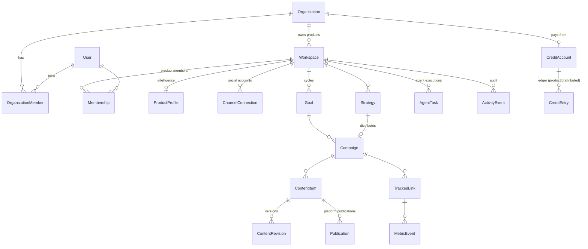
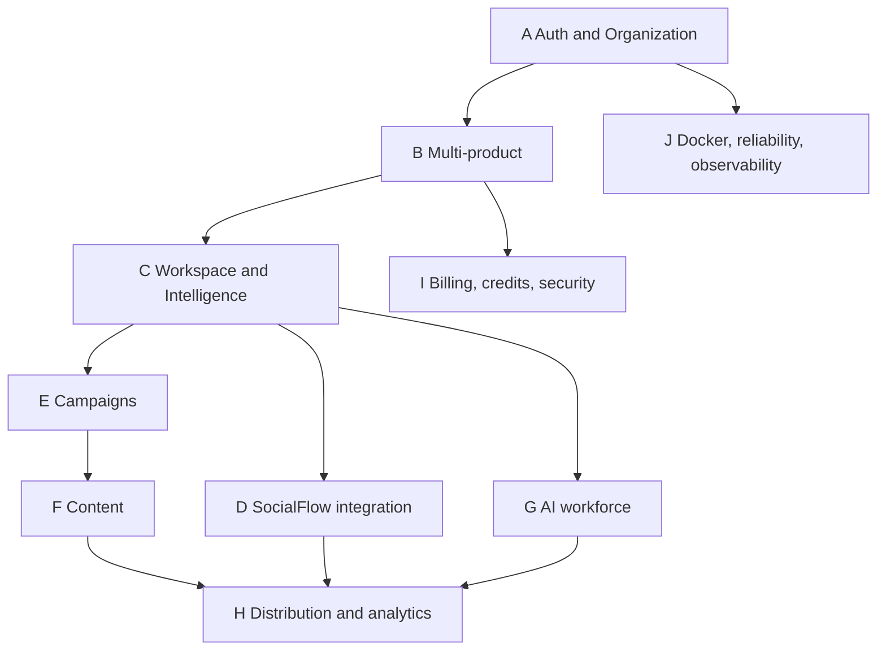

# Banyan as a multi-product distribution OS — Phase 0 checkpoint

Date: 2026-11-01. Answers the "God mode" brief's §22 checkpoint (items 1–5, 7–12). Item 6, the user stories, is in
[`docs/user-stories/MULTI_PRODUCT_BACKLOG.md`](../user-stories/MULTI_PRODUCT_BACKLOG.md). The decision record is
[ADR-005](../ARCHITECTURE_DECISIONS.md#adr-005).

---

## 1. Existing repository assessment

**Stack.** Next.js 15 App Router (UI and API in one process), React 19, TypeScript strict, Prisma 6 on PostgreSQL 16,
Redis 7 with BullMQ (queue, worker, scheduler), zod at every boundary, Vitest (635 tests), Docker Compose (web, worker,
migrate, postgres, redis, plus an optional SocialFlow Lite profile). SocialFlow Lite is a separate Go service (branch
`socialflow-lite` of `kael-tombo/socialFlow`).

**Size.** 272 TS/TSX files, 31 Prisma models, 25 API route groups, 74 `workspaceId` references in the schema.

**What works today (verified this session or earlier):**

| Area | State |
| --- | --- |
| Auth | Email/password, sign-in with Google, Microsoft, GitHub, LinkedIn, Facebook and X, DB sessions, CSRF same-origin checks, rate limits |
| Tenant isolation | Every query is scoped by `workspaceId`, and `requireWorkspace()` runs on every route; E2E cross-workspace 401/404 checks |
| Product intelligence | URL analysis of up to 3 pages, SSRF-safe, injection-isolated, then a reviewed and approved profile with field provenance |
| Strategy | Structured, cited, versioned; approve, reject or regenerate |
| Content | Drafts from the strategy, revision history, revision-specific approval, a claims guard that holds approval |
| Campaigns | One lifecycle, pause/resume/cancel, distribute with partial-failure handling, credit-charged drafts |
| Cycles | A strategy opens a cycle; cycle report; next move from the numbers; next cycle carrying one change |
| Autonomy | Level 1 autopilot; Level 2 supervised policy (auto-approve or schedule within founder rules, with escalations) |
| Distribution | Provider-neutral interface; SocialFlow adapter over REST or MCP; export mode; bounded retries and idempotency |
| SocialFlow Lite | LinkedIn and X OAuth, publish/schedule/thread resume, MCP server, doctor, key rotation, access log |
| MCP | Banyan's own read-only MCP server with personal access tokens |
| Credits | Ledger with reservation, settlement and refund, safe under concurrency (per workspace) |
| Measurement | Tracked links, first-party signup attribution, cycle report, activation funnel report |

**Known gaps relevant to the brief:** no Organization entity; requests always resolve to a user's *first* workspace;
no product switcher; no organization dashboard; credits are per workspace rather than per organization; roles are
`owner | member | viewer` per workspace; no knowledge base or retrieval; agents are 6 fixed roles rather than a
registry; no automation builder; no media or object storage; no notifications or email; no real social publish verified
yet (needs the founder's developer apps); two cycle pipelines still exist
([decision doc](../DECISION_ONE_CYCLE_PIPELINE.md)). Technical debt: [TECHNICAL_DEBT.md](../TECHNICAL_DEBT.md),
including TD-17 (ModelCall does not cascade).

**Conflict to note.** [STRATEGY.md](../../STRATEGY.md) §10 lists "multi-product onboarding, agency mode" as **out of
the MVP**. This brief makes it the centre. ADR-005 records the change of direction. The single-product MVP promise
(one complete approved cycle) stays intact and becomes "one product's cycle".

## 2. Target architecture

**Principle: add the organization layer above what already isolates products; do not rewrite.**

```
Organization ─┬─ OrganizationMember (OWNER | ADMIN | MEMBER | BILLING_MANAGER)
              ├─ CreditAccount / CreditEntry (moves up from workspace; entries keep productId attribution)
              ├─ ApiToken (org-level later; product-scoped today)
              └─ Product  ≡ existing Workspace (one row = one product, all 31 product tables already scoped)
                    ├─ Membership → ProductMember (PRODUCT_ADMIN | MARKETING_MANAGER | CONTENT_EDITOR | ANALYST | VIEWER)
                    ├─ ProductProfile (intelligence), brand voice → Brand Studio
                    ├─ ChannelConnection → product ↔ SocialFlow account mapping
                    ├─ Strategy, Campaign, Goal (cycle), ContentItem, ContentRevision, Publication, TrackedLink
                    ├─ AgentTask (execution log), autonomy policy, Recommendation, Experiment
                    └─ ActivityEvent (audit), ModelCall (usage)
```

- **Product = Workspace.** The table keeps its name (`Workspace`) to avoid touching all 31 models and every query.
  The UI and API call it a product. `Workspace` gains `organizationId`, `productType` and `status`.
- **Active product** is chosen by a signed cookie, and validated on every request against membership in that product
  (or org-level OWNER/ADMIN). `requireWorkspace()` keeps its signature, so all existing routes become product-aware
  without edits. An unknown or forbidden product ID falls back to a product the user can access, never to someone
  else's.
- **Authorization** composes the organization role (OWNER/ADMIN see every product) with the product role
  (Membership.role, extended). Server-side only.
- **Modular monolith stays** (ADR-001/002). No new infrastructure until a feature needs it: object storage arrives
  with media, and a vector store arrives with the knowledge base (pgvector in the same Postgres first).

## 3. Technology stack assessment

Keep everything. The brief's needs map as follows:

| Need | Choice |
| --- | --- |
| Multi-tenant data | Prisma on Postgres with composite ownership checks in services (`findFirst({ where: { id, workspaceId } })`), already the house pattern |
| Background jobs | BullMQ (existing) |
| Retrieval (knowledge base) | pgvector extension on the existing Postgres, when that epic starts |
| Media | S3-compatible object storage (MinIO in Compose), when media publishing starts; SocialFlow Lite needs media support first |
| IDs | **cuid** stays; the brief asks for UUIDs. cuids are collision-resistant, non-sequential, URL-safe random IDs, and converting every primary key would rewrite every table for no security gain. Recorded in ADR-005 |

## 4. Domain model — the brief's entities against this codebase

| Brief entity | Status | Where / plan |
| --- | --- | --- |
| organizations, organization_members, organization_invitations | **New** | `Organization`, `OrganizationMember`; invitations with the email capability (US-010/017) |
| subscriptions, credit_accounts, credit_transactions | Partly exists | `CreditAccount` and `CreditEntry` exist per workspace and move up to the organization; subscriptions with Stripe (blocker 11) |
| products, product_members, product_settings | **Exists as `Workspace`, `Membership`** | add `organizationId`, `productType`, `status`; extend roles |
| product_profiles, product_brand_profiles | Exists | `ProductProfile` (with `brandVoice` JSON); split brand out when Brand Studio needs assets |
| social_connections, product_social_accounts, social_capabilities | Exists | `ChannelConnection` (product-scoped credential) plus SocialFlow accounts and capabilities via the contract (C3/C4) |
| campaigns, campaign_channels, campaign_kpis, campaign_approvals | Exists (JSON columns) | `Campaign` with channels/formats JSON, lifecycle; approvals in `ActivityEvent` |
| content_assets, content_versions, content_platform_variants | Exists | `ContentItem`, `ContentRevision`, adaptations JSON |
| media_assets | Gap | with object storage |
| distribution_jobs, publication_records, distribution_attempts | Exists | `Publication` (status, attempts, provider response) and BullMQ jobs |
| webhook_events | Gap | SocialFlow Lite has no webhooks yet (US-036) |
| ai_agents, agent_tools, agent_permissions, agent_executions | Partly exists | `AgentTask` holds executions; a registry with tools and permissions is new (Epic G) |
| agent_memories | Partly exists | learning memory from experiments, plus `ProfileFact` |
| knowledge_sources, documents, chunks, embeddings | Gap | Epic C |
| automation_workflows, triggers, runs | Partly exists | autopilot and supervision are fixed automations; a configurable builder is new |
| analytics_events, snapshots, campaign_metrics, product_metrics | Exists | `MetricEvent`, `CampaignMetric`, `TrackedLink`; snapshots computed |
| audit_logs, notifications, background_jobs | Partly exists | `ActivityEvent` is the audit log; notifications are a gap; jobs live in BullMQ |

## 5. Entity relationship design (target)



## 7. Dependency graph (epic level; story-level graph in the backlog)



## 8. SocialFlow integration gap analysis

The SocialFlow.ai repository itself has no runnable API ([audit](../SOCIALFLOW_INTEGRATION_AUDIT.md)). SocialFlow Lite
implements Banyan's contract. Against the brief's §8.2 capability list:

| Capability | Status |
| --- | --- |
| social.accounts.list / connect / disconnect | **Done** (C2, C3, C10; REST and MCP) |
| social.capabilities.get | **Done** (C4; per-account capabilities plus token expiry) |
| social.posts.create / publish / schedule / get | **Done** (C5–C7; idempotency keys, thread resume) |
| social.media.upload | **Gap**: text only; needs object storage plus LinkedIn/X media upload |
| social.posts.cancel | **Gap**: no cancel for scheduled posts in Lite |
| social.analytics.get | **Gap (honest)**: answers `not_found`; Banyan's analytics are first-party tracked links |
| Webhooks | **Gap**: Banyan schedules itself and reads status back; status webhooks would need signing |
| Rate limits, error classification, retries, idempotency | **Done** (Retry-After honoured, bounded retries, one idempotency store) |
| Product ↔ account mapping (§8.3) | **Done by construction**: each Banyan product holds its own SocialFlow API key, and in SocialFlow Lite an organisation's accounts are invisible to other keys. One product can never publish to another product's account |
| Verified against real platforms | **Blocked** on the founder's LinkedIn/X developer apps |

## 9. Docker architecture

`docker compose up -d --build` starts web, worker, migrate (one-shot), postgres and redis, with health checks, named
volumes and `unless-stopped`. `--profile socialflow` adds SocialFlow Lite. Planned additions, only when their epics
start: MinIO (media) and the pgvector extension (knowledge base). Development and production profiles are US-008
(existing backlog).

## 10. Security threat assessment (multi-product additions)

| Threat | Mitigation |
| --- | --- |
| IDOR through the active-product cookie (setting it to another org's product) | The cookie is only a *preference*: each request re-validates membership in that product, or OWNER/ADMIN of its organization, server side; otherwise the user falls back to an accessible product |
| Cross-product access by guessed resource ID | Existing pattern `findFirst({ where: { id, workspaceId } })` on every route; new product routes add `organizationId` checks; tests for each new endpoint |
| Privilege escalation (product role → org role) | Org roles live only in `OrganizationMember`; a product role never grants org actions; tests |
| Publishing to an unassigned account | Accounts are reachable only through the product's own SocialFlow key (§8) |
| Token misuse (MCP) | Read-only tools, hashed tokens, per-user per-product scope, membership re-check, rate limit |
| Prompt injection from websites | Untrusted-content isolation exists (US-024); agent tools stay permissioned |
| Credit double-spend across products | Org-level ledger with idempotency keys and a row-locked balance (the current ledger design, lifted) |
| Data leakage in logs | Structured logs with redaction (US-064, open); SocialFlow Lite already redacts |

## 11. Phased implementation plan

| Brief phase | State | Next concrete work |
| --- | --- | --- |
| 0 Reconnaissance | This document | — |
| 1 Foundations | Auth, migrations, Docker, audit (ActivityEvent) **done** | `Organization`, `OrganizationMember`, backfill one organization per existing workspace (BOS-001…007) |
| 2 Multi-product | **Starting now** | active-product selection, product list/create API, product switcher, organization dashboard (BOS-008…015) |
| 3 Onboarding | Profile, analysis, approval done; 9-stage tracker exists | organization step, first-product step, objectives (BOS-016…022) |
| 4 SocialFlow | Contract, adapter, REST and MCP, Lite **done**; live verification blocked | media, cancel, webhooks (BOS-023…030) |
| 5 Campaigns and content | Lifecycles **done** | per-product templates, platform variants UI |
| 6 AI workforce | 6 roles, autopilot, supervision **done** | agent registry with tools and permissions; 15 roles as configurations, not code |
| 7 Analytics and automation | First-party analytics and cycle report **done** | organization rollups, automation builder, notifications |
| 8 Hardening | Partial | security tests per new endpoint, logs, backups |

## 12. Critical risks and assumptions

- **Scope risk (highest).** The brief is a multi-quarter product. The single-product promise is not yet verified on a
  real platform. Mitigation: multi-product is built as a thin layer that keeps every existing flow working, and the
  live publish stays the release gate.
- **Migration risk.** Backfilling an organization for every existing workspace must be lossless and reversible. Done
  in one SQL migration, one organization per workspace, with the workspace's owners as OWNER.
- **Assumption:** one Banyan user may own several organizations, but the UI starts with one active organization.
- **Assumption:** "product = workspace" is acceptable naming debt. The UI says "product" everywhere new.
- **Not invented:** external API contracts, provider capabilities, metrics. Gaps stay labelled as gaps.
