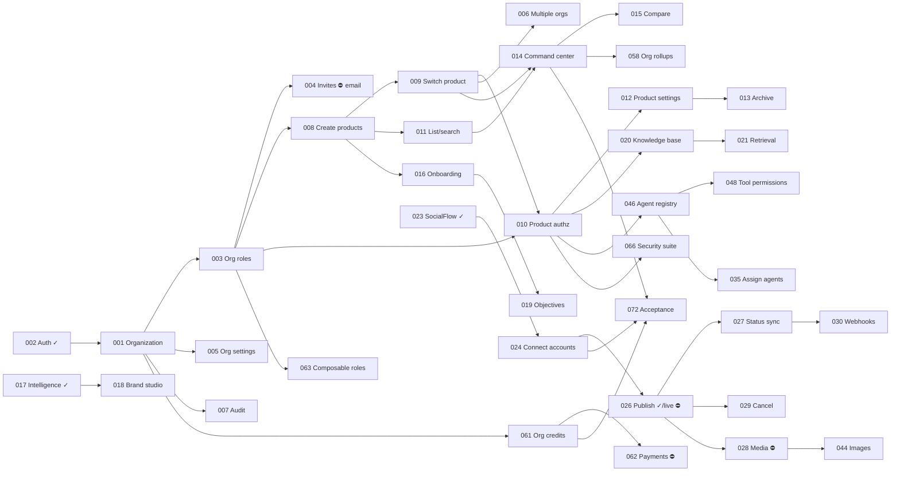

# Multi-product backlog (BOS-001 … BOS-072)

The "God mode" brief's backlog, written against the real codebase (Phase 0:
[MULTI_PRODUCT_PHASE0.md](../architecture/MULTI_PRODUCT_PHASE0.md), ADR-005). IDs are **BOS-** because `US-001…077`
already name the single-product backlog ([USER_STORIES.md](../USER_STORIES.md)). Where a BOS story is already met by
working code, it says **DONE** and names the US story or commit that delivered it, rather than restating it.

**Status legend:** BLOCKED · READY · IN_PROGRESS · REVIEW · TESTING · DONE. A story is DONE only when its acceptance
criteria and tests pass.

**Conventions used by every story.** "Product" = a `Workspace` row (ADR-005). Every product-scoped query is
`where: { id, workspaceId }`. Every org-scoped query is `where: { id, organizationId }`. Every mutating route checks
same-origin (CSRF), validates with zod and is rate-limited where public.

---

## Epic A — Authentication and Organization

### BOS-001 — An organization for every founder
- **Role** Founder · **Status** IN_PROGRESS · **Depends on** BOS-002 · **Maps to** new
- **Story** As a founder, I want my account to belong to an organization, so that all my products, members and credits live under one business.
- **Value** The trunk of the tree: everything multi-product hangs off it.
- **Functional** 1) Signup creates an organization named after the user and makes them OWNER. 2) Each existing workspace is backfilled into its own organization, with its owners as OWNER. 3) The organization has a name, a slug and a created date.
- **Technical** Prisma models `Organization` and `OrganizationMember`; `Workspace.organizationId` (required after the backfill migration); a transaction in signup.
- **Data** organizations, organization_members, workspaces · **API** internal (signup) · **UI** none
- **Acceptance** A new signup has exactly one org with them as OWNER; every pre-existing workspace has an org; migration is lossless (row counts equal).
- **Tests +** signup creates the org and membership; the backfill gives N workspaces N orgs. **Tests −** signup failure leaves no orphan org (transaction); a duplicate slug gets a suffix.
- **Security** Organization IDs are random cuids, never derived from names.

### BOS-002 — Register and sign in
- **Role** Visitor · **Status** DONE · **Depends on** — · **Maps to** US-013, US-014, sign-in providers commit 341a806
- **Story** As a visitor, I want to register and sign in securely, so that my organization is protected.
- **Value** Entry to the product. **Functional** email/password plus 6 OAuth providers; DB sessions; logout.
- **Technical** bcrypt cost 12, HMAC-bound session cookie, rate-limited login/signup. **Data** users, sessions, oauth_accounts · **API** `/api/auth/*` · **UI** /login, /signup
- **Acceptance / tests** E2E acceptance script: signup, login, bad login, logout (passing). **Security** httpOnly, sameSite=lax, secure in prod.

### BOS-003 — Organization roles
- **Role** Organization owner · **Status** READY · **Depends on** BOS-001 · **Maps to** new
- **Story** As an owner, I want members to hold OWNER, ADMIN, MEMBER or BILLING_MANAGER roles, so that I control who manages products, people and money.
- **Value** Safe delegation. **Functional** 1) Role on `OrganizationMember`. 2) OWNER/ADMIN see and manage every product. 3) MEMBER sees only products they are a member of. 4) BILLING_MANAGER sees billing and credits only. 5) At least one OWNER always remains.
- **Technical** a pure policy `orgCan(role, action)` with unit tests; checked in services.
- **Data** organization_members · **API** used by every org route · **UI** role badges
- **Acceptance** Each role is allowed exactly its actions (policy table tests); demoting the last OWNER is refused.
- **Tests +** OWNER creates a product; ADMIN invites. **Tests −** MEMBER cannot create a product; BILLING_MANAGER cannot read campaigns; last-owner demotion refused.
- **Security** Product roles never grant org actions.

### BOS-004 — Invite members to the organization
- **Role** Owner/Admin · **Status** BLOCKED (email delivery, blocker 06) · **Depends on** BOS-003, US-010 · **Maps to** US-017
- **Story** As an admin, I want to invite a colleague by email with a role, so that they can work on chosen products.
- **Value** Teams. **Functional** invitation with role and optional product list; expiring single-use token; accept → membership(s).
- **Technical** `OrganizationInvitation` (hashed token, 7-day expiry). **Data** organization_invitations · **API** `POST /api/organizations/{id}/invitations`, `POST /api/invitations/accept` · **UI** Members page
- **Acceptance** The invitee joins with exactly the given role and products; a reused or expired token is refused.
- **Tests +** invite, then accept. **Tests −** expired, reused, wrong-email, or MEMBER inviting are refused.
- **Security** Tokens are hashed, constant-time comparison, rate-limited.

### BOS-005 — Organization settings
- **Role** Owner · **Status** READY · **Depends on** BOS-001 · **Maps to** extends US-019
- **Story** As an owner, I want to rename my organization and set its default time zone, so that all products start from my business defaults.
- **Value** Identity and defaults. **Functional** name, slug, default time zone, type, team size; new products inherit the time zone.
- **Data** organizations · **API** `PATCH /api/organizations/{id}` · **UI** Settings → Organization
- **Acceptance** Changes persist; non-owners get 403. **Tests +** rename. **Tests −** an empty name is refused (400); MEMBER gets 403; another org's id gets 404.
- **Security** Org id taken from session membership, never from the body.

### BOS-006 — Belong to several organizations
- **Role** Agency user · **Status** READY · **Depends on** BOS-001, BOS-009 · **Maps to** new
- **Story** As someone working for several businesses, I want to switch organization, so that one login serves all of them.
- **Value** Agencies and consultants. **Functional** an organization switcher appears when the user belongs to more than one; switching resets the active product to one in that org.
- **Technical** an active-org preference cookie, validated per request. **Data** organization_members · **API** `POST /api/session/organization` · **UI** switcher above the product selector
- **Acceptance** Switching never exposes products of an org the user is not in. **Tests −** tampered cookie → falls back to a member org.
- **Security** Same validation as BOS-010.

### BOS-007 — Audit log of organization actions
- **Role** Owner · **Status** IN_PROGRESS · **Depends on** BOS-001 · **Maps to** ActivityEvent (exists per product)
- **Story** As an owner, I want every org-level change (products, members, roles, credits) logged with who and when, so that I can trust and trace the system.
- **Value** Accountability. **Functional** activity rows for org actions, attributed to the user; visible to OWNER/ADMIN.
- **Technical** reuse `ActivityEvent` with the product id when there is one; org events also carry `organizationId` in meta (a column later).
- **Data** activity_events · **API** reads in the org dashboard · **UI** Organization activity
- **Acceptance** Creating a product writes an attributed event. **Tests** event present after create; no secrets in meta.
- **Security** Append-only from application code.

## Epic B — Multi-Product Management

### BOS-008 — Create multiple products
- **Role** Organization owner/admin · **Status** IN_PROGRESS · **Depends on** BOS-001, BOS-003 · **Maps to** new
- **Story** As an organization owner, I want to create multiple products, so that I can independently manage the distribution of each business from one Banyan account.
- **Value** No separate Banyan account per business.
- **Functional** 1) A create-product action. 2) Name (required). 3) Product type (SaaS, Web app, Mobile app, E-commerce, Developer tool, Digital product, Agency service, Personal brand, Other). 4) Optional website URL. 5) Created under the active organization. 6) Unique id. 7) Default settings: time zone from the org, a starter credit policy. 8) The creator becomes PRODUCT_ADMIN. 9) The user lands in the new product. 10) The selector updates.
- **Technical** One transaction creates the `Workspace` (product) and `Membership`; the slug is unique.
- **Data** workspaces (products), memberships · **API** `POST /api/organizations/{orgId}/products` (the org is resolved from the session; a mismatched orgId gets 404) · **UI** product selector "New product", modal
- **Acceptance** Owner/admin can create; MEMBER gets 403; no creation outside the active org; name validated (1–80 chars); IDs unique; the product appears in the selector immediately; a failed creation leaves no partial rows.
- **Tests +** a valid product. **Tests −** missing name (400), MEMBER (403), another org's id (404), simulated failure leaves no partial rows (transaction), workspace initialized with an admin membership.
- **Security** The org is validated server side; the product id is never accepted from the client.

### BOS-009 — Switch the active product
- **Role** Any member · **Status** IN_PROGRESS · **Depends on** BOS-008 · **Maps to** new
- **Story** As a founder, I want to switch between my products, so that every screen shows that product's data and nothing else.
- **Value** The multi-workspace experience.
- **Functional** 1) Selecting a product sets the active product. 2) All pages and APIs then load that product. 3) The active product is visible at all times. 4) The choice is never changed silently, and a change says so.
- **Technical** a signed preference cookie; `requireWorkspace()` resolves the active product among the user's accessible products and falls back to the first accessible one.
- **Data** memberships, organization_members · **API** `POST /api/session/product` · **UI** product selector in the rail
- **Acceptance** After switching, `/api/campaigns` returns only that product's campaigns; a cookie naming an inaccessible product is ignored.
- **Tests +** switch A→B shows B's data. **Tests −** a forged cookie to another org's product falls back; a product the user was removed from falls back.
- **Security** The cookie is a preference, never authorization.

### BOS-010 — Product-level authorization
- **Role** Organization owner · **Status** IN_PROGRESS · **Depends on** BOS-003, BOS-009 · **Maps to** extends US-016
- **Story** As an owner, I want a member to access Product A but not Product B, so that freelancers and teams see only their work.
- **Value** Safe collaboration across businesses.
- **Functional** product access = product Membership, or org OWNER/ADMIN; product roles PRODUCT_ADMIN, MARKETING_MANAGER, CONTENT_EDITOR, ANALYST, VIEWER map onto today's write/approve/read checks.
- **Technical** extend `permissions.ts` with role → capability; `requireRole` keeps its API.
- **Data** memberships · **API** all product routes · **UI** none (enforced server side)
- **Acceptance** A member of A gets 404 for B's resources by direct id. **Tests −** IDOR across products for campaigns, content, connections, tokens.
- **Security** Every lookup includes the product id.

### BOS-011 — List and search products
- **Role** Member · **Status** IN_PROGRESS · **Depends on** BOS-008 · **Maps to** new
- **Story** As a founder with many products, I want to search my products and see recently used ones, so that switching is fast.
- **Value** Speed at scale. **Functional** list with name, type, logo initial and status; search; the last 3 used first.
- **Data** workspaces · **API** `GET /api/products` · **UI** selector with search
- **Acceptance** Only accessible products are listed. **Tests −** another org's products never appear.
- **Security** The list is filtered by access, not just by org.

### BOS-012 — Product settings
- **Role** Product admin · **Status** READY · **Depends on** BOS-010 · **Maps to** extends US-019
- **Story** As a product admin, I want to edit the product's name, type, website and time zone, so that its workspace reflects the business.
- **Data** workspaces · **API** `PATCH /api/products/{id}` · **UI** Product settings
- **Acceptance** Persisted; VIEWER gets 403; another product's id gets 404. **Tests ±** as stated. **Security** composite ownership check.

### BOS-013 — Archive and restore a product
- **Role** Owner · **Status** READY · **Depends on** BOS-012 · **Maps to** new
- **Story** As an owner, I want to archive a product I no longer market, so that it leaves my selector and agents stop working on it, without losing its history.
- **Functional** status `archived` hides it from the selector and stops autopilot/supervision; restore brings it back; data is kept (soft delete).
- **Data** workspaces.status · **API** `POST /api/products/{id}/archive|restore` · **UI** settings danger zone
- **Acceptance** An archived product's agents do nothing (autopilot checks status). **Tests −** a non-owner gets 403; the last active product cannot be archived.
- **Security** Archive is logged.

### BOS-014 — Founder command center
- **Role** Founder · **Status** IN_PROGRESS · **Depends on** BOS-009, BOS-011 · **Maps to** extends dashboard
- **Story** As a founder, I want one dashboard across all products (pending approvals, active cycles, scheduled and published posts, failures, credits, outcomes per product), so that I know where to look first.
- **Value** The organization-level view the brief centres on.
- **Functional** per-product rows: waiting-on-you count, active cycle and progress, published (14 days), failures, tracked visits/signups (14 days); org totals; links that switch product and open the screen.
- **Technical** aggregated queries grouped by `workspaceId` over the user's accessible products only.
- **Data** content_items, goals, publications, metric_events, credit_accounts · **API** server component (and `GET /api/organizations/{id}/overview`) · **UI** /app/organization
- **Acceptance** Numbers equal the per-product pages; products the user cannot access are excluded; empty products say so honestly.
- **Tests +** two products with known rows give known totals. **Tests −** a member of A only sees A's row.
- **Security** The aggregation is filtered by access.

### BOS-015 — Compare products
- **Role** Founder · **Status** READY · **Depends on** BOS-014 · **Maps to** new
- **Story** As a founder, I want to compare products on the same first-party metrics over a chosen period, so that I invest where distribution works.
- **Functional** date range (7/30/90 days); visits, signups, published posts, cycles completed per product; no invented metrics.
- **API** `GET /api/organizations/{id}/compare?days=` · **UI** comparison table
- **Acceptance** "Not measured" is shown for products without tracked links. **Tests** known fixtures. **Security** access-filtered.

## Epic C — Workspace and Product Intelligence

### BOS-016 — Guided product onboarding
- **Role** Founder · **Status** IN_PROGRESS · **Depends on** BOS-008 · **Maps to** US-018…US-041 (9-stage tracker exists)
- **Story** As a founder, I want a guided setup from organization to first product to an approved first cycle, so that a URL becomes a working product workspace.
- **Functional** organization step (BOS-005 fields), first product (BOS-008), intelligence (BOS-017), brand (BOS-018), objectives (BOS-019), SocialFlow (BOS-024), agents (BOS-046), first strategy (US-042), approval, ready. Save and resume per product.
- **Data** onboarding_stages (per product) · **API** `/api/onboarding/*` · **UI** /onboarding
- **Acceptance** Resume exactly where left; nothing is published without approval. **Tests** resume after reload; skip never fakes completion.
- **Security** Stage writes are product-scoped.

### BOS-017 — Product intelligence from a URL
- **Role** Founder · **Status** DONE · **Maps to** US-021, US-022, US-023, US-024
- **Story** As a founder, I want Banyan to read my product site and draft the profile for my review, so that agents work from my real product. · **Acceptance/tests** SSRF-safe fetch of up to 3 pages, injection isolation, field provenance, approval gate (passing). **Security** untrusted content isolated.

### BOS-018 — Brand studio basics
- **Role** Marketing manager · **Status** READY · **Depends on** BOS-017 · **Maps to** US-026
- **Story** As a marketing manager, I want each product's tone, words to avoid, required disclosures and colours stored with the product, so that every agent writes in that brand.
- **Functional** tone, themes, avoid list (already used by the claims and brand checks), disclosures, primary colour, logo URL.
- **Data** product_profiles.brandVoice (JSON), later product_brand_profiles · **API** `PATCH /api/profile` (extend) · **UI** Brand studio
- **Acceptance** Drafts for Product B never use Product A's avoid list (per-product evidence). **Tests −** cross-product brand leakage. **Security** product-scoped.

### BOS-019 — Marketing objectives per product
- **Role** Founder · **Status** READY · **Depends on** BOS-016 · **Maps to** extends profile goal
- **Story** As a founder, I want to pick a product's objectives (awareness, launch, leads, traffic, acquisition, community, conversion, retention), so that strategies aim at the right outcome.
- **Data** product_profiles.goal (extend to a list) · **API** profile · **UI** onboarding step
- **Acceptance** The strategy prompt includes the objectives. **Tests** prompt contains them. **Security** —

### BOS-020 — Knowledge base: documents and URLs
- **Role** Content editor · **Status** READY · **Depends on** BOS-010 · **Maps to** new
- **Story** As an editor, I want to add documents, FAQs and competitor notes to a product, so that agents ground claims in them.
- **Functional** add text or a URL (SSRF-safe fetch) to the product; list and delete; documents count as claim evidence.
- **Technical** `KnowledgeDocument` (product-scoped, provenance); retrieval keyword-first, pgvector later.
- **Data** knowledge_documents · **API** `/api/knowledge` · **UI** Knowledge page
- **Acceptance** A document in A backs a claim in A, never in B. **Tests −** cross-product retrieval. **Security** untrusted text isolated in prompts.

### BOS-021 — Knowledge retrieval for agents
- **Role** Agent (system) · **Status** BLOCKED (on BOS-020) · **Maps to** new
- **Story** As an agent, I need the product's relevant knowledge passages, so that strategies and drafts cite real material. · **Technical** chunking, embeddings in pgvector, top-k by product id. **Acceptance** retrieval never crosses product ids (test). **Security** product filter in the SQL itself.

### BOS-022 — Product overview page
- **Role** Member · **Status** DONE (as the dashboard) · **Maps to** dashboard, launch path, day-zero mode (commit cdaf67a)
- **Story** As a member, I want the product's status, waiting items, cycle and next action on one page. · **Acceptance** passing (rendered and checked in a browser).

## Epic D — SocialFlow.ai Integration

### BOS-023 — SocialFlow provider per product
- **Role** Product admin · **Status** DONE · **Maps to** US-027, US-030, US-031; commits d9454f0, cf73787
- **Story** As a product admin, I want my product connected to SocialFlow with its own API key, so that only this product's accounts are reachable. · **Acceptance/tests** contract tests, REST and MCP transports, cross-repo smoke (passing). **Security** key encrypted at rest (AES-256-GCM); accounts isolated per SocialFlow organisation.

### BOS-024 — Connect social accounts to a product
- **Role** Product admin · **Status** REVIEW · **Maps to** US-032 (commit d82360e)
- **Story** As a product admin, I want to connect LinkedIn or X to this product through SocialFlow, so that its approved posts publish there. · **Functional** connect URL in a new tab, account list with status, capabilities and token expiry, disconnect revokes. **Acceptance** account appears with capabilities (verified against a stand-in provider; a real account is pending the developer apps). **Tests −** a viewer cannot connect; javascript: connect URLs refused.

### BOS-025 — Capability discovery in the UI
- **Role** Content editor · **Status** DONE · **Maps to** US-033 (registry), C4
- **Story** As an editor, I want only the operations an account supports to be offered. · **Acceptance** capabilities shown per account; analytics marked unavailable honestly.

### BOS-026 — Publish now and schedule through SocialFlow
- **Role** Content editor · **Status** DONE (code) / BLOCKED (live verification on real accounts) · **Maps to** US-049, C5/C6
- **Story** As an editor, I want approved posts published or scheduled through the product's accounts. · **Acceptance** idempotent, approval re-checked on every attempt, thread resume (tests passing); live run pending.

### BOS-027 — Publication status sync
- **Role** Content editor · **Status** READY · **Depends on** BOS-026 · **Maps to** US-035
- **Story** As an editor, I want queued or scheduled publications reconciled with SocialFlow's status, so that "published" is always confirmed.
- **Functional** the worker polls getStatus (C7) for publications in attempting or queued with backoff; it updates the URL and status.
- **Data** publications · **API** worker job · **UI** status badges
- **Acceptance** A queued post becomes published only on provider confirmation. **Tests** the mock provider moves queued → published. **Security** product-scoped credentials.

### BOS-028 — Media upload for posts
- **Role** Content editor · **Status** BLOCKED (SocialFlow Lite media; object storage) · **Maps to** new
- **Story** As an editor, I want to attach an image to a post. · **Technical** MinIO in Compose; SocialFlow Lite media endpoints (LinkedIn images API, X media upload, already proven in OpenPost upstream). **Acceptance** an image post publishes with a confirmed URL. **Security** content-type and size limits, safe image types only.

### BOS-029 — Cancel a scheduled post
- **Role** Content editor · **Status** READY · **Depends on** BOS-026 · **Maps to** new (needs a Lite DELETE /v1/posts/{id} while scheduled)
- **Story** As an editor, I want to cancel a scheduled post before it goes out. · **Acceptance** cancelled posts never publish (scheduler test). **Tests −** cancelling a published post returns 409.

### BOS-030 — Signed status webhooks
- **Role** System · **Status** READY · **Depends on** BOS-027 · **Maps to** US-036
- **Story** As Banyan, I want SocialFlow to notify publication outcomes with an HMAC signature, so that status arrives without polling. · **Acceptance** an unsigned or replayed webhook is rejected (timestamp window plus id dedupe). **Security** HMAC-SHA256, constant-time compare.

## Epic E — Campaign Management

### BOS-031 — Campaigns scoped to a product
- **Role** Marketing manager · **Status** DONE · **Maps to** US-046 (lifecycle), tenant tests
- **Story** As a marketing manager, I want each product's campaigns kept apart. · **Acceptance** E2E: another workspace's campaign is 404 (passing). Workflow B (multi-product isolation) is re-run per product in BOS-072.

### BOS-032 — Campaign lifecycle with approval
- **Role** Marketing manager · **Status** DONE · **Maps to** US-046, US-048
- **Story** As a manager, I want draft → approved → active → paused → completed/cancelled with every move logged. · **Acceptance** state machine tests (passing).

### BOS-033 — Campaign from a strategy opens a cycle
- **Role** Founder · **Status** DONE · **Maps to** commit f9182eb
- **Story** As a founder, I want approving a strategy to open a measurable cycle (objective, KPI, window). · **Acceptance** end-to-end check (passing).

### BOS-034 — Campaign KPIs and targets
- **Role** Manager · **Status** REVIEW · **Maps to** cycle report (commit 29d50f3)
- **Story** As a manager, I want each campaign's KPI target measured from recorded rows only. · **Acceptance** cycle report tests (passing).

### BOS-035 — Assign agents to a campaign
- **Role** Manager · **Status** BLOCKED (on BOS-046) · **Maps to** new
- **Story** As a manager, I want to choose which product agents work on a campaign. · **Data** campaign_agents · **Acceptance** an agent outside the product cannot be assigned (test).

### BOS-036 — Campaign approval history
- **Role** Owner · **Status** DONE · **Maps to** ActivityEvent approvals, autonomy decisions
- **Story** As an owner, I want every approval and autonomous decision on a campaign listed with who, when and why. · **Acceptance** activity rows present for approvals and policy decisions (tests passing).

### BOS-037 — Campaign templates shared across products
- **Role** Owner · **Status** READY · **Depends on** BOS-001 · **Maps to** new
- **Story** As an owner, I want organization-scoped campaign templates any product can start from, without sharing campaign data. · **Data** campaign_templates (organizationId) · **Acceptance** a template copy is product-scoped; the original never links to product data.

### BOS-038 — Campaign performance per channel
- **Role** Analyst · **Status** DONE · **Maps to** results.ts channel performance, cycle recommender
- **Story** As an analyst, I want visits and signups by channel per campaign. · **Acceptance** tests (passing).

## Epic F — Content Management

### BOS-039 — Content lifecycle
- **Role** Editor · **Status** DONE · **Maps to** US-050, US-051, US-052
- **Story** As an editor, I want idea → draft → review → approved → scheduled → published/failed, with revision-specific approval. · **Acceptance** tests (passing).

### BOS-040 — Platform-specific variants
- **Role** Editor · **Status** DONE · **Maps to** adaptations in the editor
- **Story** As an editor, I want one asset with per-platform versions. · **Acceptance** adaptations stored per item (passing).

### BOS-041 — Brand-safe and claim-safe drafts
- **Role** Editor · **Status** DONE · **Maps to** US-054 (commit 433ec5c)
- **Story** As an editor, I want drafts checked against the product's brand rules and evidence before approval. · **Acceptance** browser-verified claim gate (passing).

### BOS-042 — Content library per product
- **Role** Editor · **Status** DONE · **Maps to** /app/content
- **Story** As an editor, I want to browse and filter this product's content. · **Acceptance** product-scoped list (tenant tests passing).

### BOS-043 — Short-video scripts
- **Role** Editor · **Status** DONE · **Maps to** video-script module
- **Story** As an editor, I want a scene-by-scene script with a manual handoff. · **Acceptance** tests (passing).

### BOS-044 — Images and carousels
- **Role** Editor · **Status** BLOCKED (BOS-028, image generation provider) · **Maps to** new
- **Story** As an editor, I want image and carousel assets per product. · **Acceptance** stored in object storage under the product's prefix.

### BOS-045 — Articles and blog posts
- **Role** Editor · **Status** READY · **Depends on** BOS-039 · **Maps to** new format
- **Story** As an editor, I want long-form article drafts from the strategy (exported, not published, until a blog integration exists). · **Acceptance** an article format exists; exported as Markdown; honest "no blog connection".

## Epic G — AI Workforce

### BOS-046 — Agent registry per product
- **Role** Product admin · **Status** READY · **Depends on** BOS-010 · **Maps to** extends 6 fixed roles
- **Story** As a product admin, I want this product's AI workforce listed with role, responsibilities, tools and status, so that I see who does what.
- **Functional** default agents per product (Manager, Researcher, Strategist, Creator, Publisher, Analyst); new roles are configuration (role, prompt name, allowed tools), not code. The brief's 15 roles map onto these plus configurations.
- **Technical** AgentDefinition (product-scoped, role, toolAllowlist JSON, enabled).
- **Data** ai_agents · **API** GET/PATCH /api/agents · **UI** AI workforce page
- **Acceptance** Disabling an agent stops its runs; agents of A are invisible in B. **Tests −** cross-product agent id gets 404.
- **Security** Tool allowlists are enforced in code, not prompts.

### BOS-047 — Explicit agent execution context
- **Role** System · **Status** REVIEW · **Maps to** AgentTask (workspaceId, goalId, campaignId)
- **Story** As Banyan, every agent run must carry organization, product, agent, campaign, tools and objective, so that it cannot reach other products. · **Acceptance** handlers read only by the task's workspaceId (existing tests); organizationId is added with BOS-001.

### BOS-048 — Agent tool permissions
- **Role** Product admin · **Status** READY · **Depends on** BOS-046 · **Maps to** new
- **Story** As a product admin, I want each agent limited to named tools (read profile, draft content, propose strategy; never publish without approval). · **Acceptance** a tool call outside the allowlist is refused and logged (test).

### BOS-049 — Execution history and usage
- **Role** Founder · **Status** DONE · **Maps to** /app/activity, ModelCall ledger, prompt versions (US-045)
- **Story** As a founder, I want every agent run's inputs, outputs, model calls and credits recorded. · **Acceptance** passing.

### BOS-050 — Approval gates for agent actions
- **Role** Founder · **Status** DONE · **Maps to** plan gate, strategy approval, content approval, supervised policy
- **Story** As a founder, I want consequential agent actions to wait for approval unless my policy allows them. · **Acceptance** autonomy check script (14 checks passing).

### BOS-051 — Supervised autonomy per product
- **Role** Founder · **Status** DONE · **Maps to** commit ad3f0b8
- **Story** As a founder, I want each product to have its own autonomy mandate. · **Acceptance** the policy is stored per workspace (product): passing.

### BOS-052 — Product AI manager coordinates the cycle
- **Role** Founder · **Status** REVIEW · **Maps to** autopilot plus next-cycle loop
- **Story** As a founder, I want a manager agent to move the cycle forward (profile → strategy → drafts → supervision → report → next move) and ask me only for decisions. · **Acceptance** end-to-end strategy-cycle check (passing); a named "manager" view is UI work.

### BOS-053 — Research agent with sources
- **Role** Founder · **Status** BLOCKED (no verified research provider) · **Maps to** P1 strategy item
- **Story** As a founder, I want market and competitor research with citations. · **Acceptance** every claim carries a source URL; without a provider, outputs stay labelled hypotheses.

### BOS-054 — Ask Banyan from any MCP client
- **Role** Founder · **Status** DONE · **Maps to** commit 291550f
- **Story** As a founder, I want Claude to answer what is waiting, how cycles do, and why a draft was flagged. · **Acceptance** official SDK interop (passing); read-only.

## Epic H — Distribution and Analytics

### BOS-055 — Distribution center per product
- **Role** Editor · **Status** DONE · **Maps to** /app/publishing, campaign distribute (US-049)
- **Story** As an editor, I want one place showing this product's connections, scheduled and published posts, failures and retries. · **Acceptance** passing; the MCP/REST transport is shown in BOS-056.

### BOS-056 — Show how publishing runs
- **Role** Product admin · **Status** READY · **Maps to** new
- **Story** As a product admin, I want the Publishing page to say whether SocialFlow runs over MCP or REST and whether it is verified, so that I know what is live. · **Acceptance** three honest states (not set up / awaiting live test / verified) plus the transport.

### BOS-057 — First-party analytics per product
- **Role** Analyst · **Status** DONE · **Maps to** tracked links, MetricEvent, /app/analytics, cycle report
- **Story** As an analyst, I want visits and signups attributed to this product's links only. · **Acceptance** passing; unavailable metrics labelled.

### BOS-058 — Organization rollup analytics
- **Role** Founder · **Status** READY · **Depends on** BOS-014 · **Maps to** new
- **Story** As a founder, I want visits, signups, publications and cycles summed across my accessible products for a period. · **Acceptance** totals equal the per-product sums (test).

### BOS-059 — Weekly product report
- **Role** Founder · **Status** BLOCKED (notifications/email, blocker 06) · **Maps to** US-072/073
- **Story** As a founder, I want a weekly report per product (decisions, publications, outcomes, next move) delivered to me. · **Acceptance** generated from recorded rows; in-app first, email when available.

### BOS-060 — Platform analytics where providers supply them
- **Role** Analyst · **Status** BLOCKED (SocialFlow analytics gap) · **Maps to** US-060
- **Story** As an analyst, I want impressions and engagement when the platform provides them. · **Acceptance** shown only with a provider source; otherwise "not collected".

## Epic I — Billing, Credits and Security

### BOS-061 — Organization credit ledger with product attribution
- **Role** Founder / Billing manager · **Status** READY · **Depends on** BOS-001 · **Maps to** US-055, US-056, US-062 (per workspace today)
- **Story** As a founder, I want one credit balance for the organization, with every entry attributed to a product, so that all products draw from one budget.
- **Functional** the balance lives on the organization; entries keep workspaceId; per-product and per-campaign usage breakdown; optional per-product monthly cap.
- **Technical** migrate CreditAccount to organizationId; reservation keys stay idempotent; the row lock moves to the org balance.
- **Data** credit_accounts, credit_entries · **API** /api/credits (org view, product filter) · **UI** Credits page with a product breakdown
- **Acceptance** Two products reserving concurrently on one balance never overspend (the existing concurrency script, adapted); a retried run is charged once.
- **Tests −** product cap exceeded → refused with nothing started. **Security** BILLING_MANAGER can view; MEMBER sees only their products' usage.

### BOS-062 — Subscriptions and payments
- **Role** Billing manager · **Status** BLOCKED (pricing decision, Stripe) · **Maps to** blocker 11
- **Story** As a billing manager, I want to subscribe and top up credits by card. · **Acceptance** Stripe webhooks are idempotent on event id; plans grant monthly credits.

### BOS-063 — Composable roles
- **Role** Owner · **Status** IN_PROGRESS · **Depends on** BOS-003, BOS-010
- **Story** As an owner, I want org roles and product roles to combine predictably. · **Acceptance** policy table tests: every (org role × product role × action) cell.

### BOS-064 — Structured logs with redaction
- **Role** Operator · **Status** READY · **Maps to** US-064
- **Story** As an operator, I want JSON logs with request ids, org and product ids, and no secrets. · **Acceptance** a test greps logs for tokens and keys.

### BOS-065 — Security headers and strict CORS
- **Role** Operator · **Status** READY · **Maps to** US-066
- **Story** As an operator, I want HSTS, CSP, frame-ancestors and same-origin APIs. · **Acceptance** headers present; CSP report-only, then enforced.

### BOS-066 — Cross-tenant security test suite
- **Role** QA · **Status** IN_PROGRESS · **Depends on** BOS-009, BOS-010
- **Story** As QA, I want automated IDOR, cross-org, cross-product, privilege escalation, duplicate publish and credit double-spend tests. · **Acceptance** suite in CI; each new endpoint adds its case.

## Epic J — Docker, Reliability and Observability

### BOS-067 — One-command stack
- **Role** Developer · **Status** DONE · **Maps to** US-001…US-004, compose profile commit e47d0f0
- **Story** As a developer, I want `docker compose up -d --build` to start Banyan (and optionally SocialFlow Lite). · **Acceptance** validated; SocialFlow Lite image build not yet run under Docker.

### BOS-068 — Health and readiness
- **Role** Operator · **Status** DONE · **Maps to** US-009, /api/health, Lite /healthz
- **Story** As an operator, I want health endpoints for every service. · **Acceptance** passing.

### BOS-069 — Backups and restore
- **Role** Operator · **Status** READY · **Maps to** US-068
- **Story** As an operator, I want nightly database backups and a timed restore drill. · **Acceptance** a restore from last night succeeds once.

### BOS-070 — Background job visibility
- **Role** Operator · **Status** REVIEW · **Maps to** BullMQ, AgentTask, maintenance sweep
- **Story** As an operator, I want failed and stuck jobs visible with their reasons. · **Acceptance** stuck jobs are swept and surfaced (existing); a jobs page is UI work.

### BOS-071 — Development, test and production profiles
- **Role** Developer · **Status** READY · **Maps to** US-008
- **Story** As a developer, I want separate compose profiles for dev, test and prod. · **Acceptance** `--profile test` runs the E2E suite against a fresh database.

### BOS-072 — Multi-product acceptance scenario
- **Role** QA · **Status** BLOCKED (on BOS-008…015, BOS-024 live, BOS-061) · **Maps to** brief §21
- **Story** As QA, I want the brief's final scenario automated: one founder, one organization, three products (SaaS, mobile, e-commerce), independent brands, accounts, campaigns and agents, a cycle on Product A through SocialFlow, no leakage to B, consolidated org dashboard. · **Acceptance** the script passes against Docker; real publishing runs on the founder's own accounts.

---

## Story dependency graph

**Implementation order (critical path):** BOS-001 → 003 → 008 → 009 → 010 → 011 → 014 → 066, then 012/013/005,
then 061, 046/048, 016/019, 027/029/030, 020/021, 015/058, 072. External blockers (⛔): email (004, 059), payments
(062), SocialFlow media and analytics (028, 044, 060), research provider (053), real accounts (026 live).
